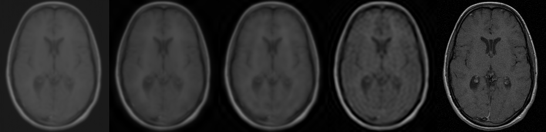

# Julia 3D Volume Fourier Domain Adaptation

A Julia implementation of **3D Fourier Domain Adaptation (3D FDA)**, as
proposed in:

> P. Sahu, J. Fishbaugh, J. Vicory, A. Khan, B. Paniagua, "3D Fourier Domain
> Adaptation for Improving CBCT Tooth Segmentation Under Scanner Parameter
> Shift," *ISBI*, 2023.

The paper extends 2D FDA (Yang & Soatto, CVPR 2020) to volumetric medical
images to solve a very practical problem: a tooth-segmentation CNN trained on
CBCT scans from one scanner protocol (e.g., with a denoising/smoothing filter
applied) fails badly when applied to scans from an updated protocol (e.g.,
sharper, unfiltered scans) — a case of **domain shift**. 3D FDA generates
augmented training volumes that keep the source volume's anatomy (and
therefore its existing segmentation labels) while adopting the target
protocol's low-level appearance, without needing any target-domain labels.

## Algorithm

The paper's core operation (Eq. 1), applied directly to 3D volumes:

```
x^{s->t} = IFFT( [ Mβ ∘ F^A(x^t) + (1 - Mβ) ∘ F^A(x^s),  F^P(x^s) ] )
```

where `F^A(x)` and `F^P(x)` are the amplitude and phase of the 3D Fourier
transform of volume `x`, and `Mβ` is a binary mask covering a small cuboid of
size `β` around the DC component (spectrum center after `fftshift`).

1. Compute the 3D FFT of both the source and target volumes and `fftshift`
   them so the zero-frequency component sits at the center.
2. Split the source spectrum into **amplitude** (style/illumination/noise
   characteristics of the scanner protocol) and **phase** (anatomical
   structure).
3. Replace only the central `β`-sized cuboid of the source's amplitude
   spectrum with the target's amplitude in that same region — this is the
   only place a swap happens.
4. Recombine with the **source's original phase**, inverse-shift, and
   inverse-FFT.

Because phase is untouched, the anatomy in the resulting volume is
essentially identical to the source (so its existing segmentation mask stays
valid), while its low-level appearance (contrast, sharpness, noise
statistics) shifts toward the target protocol.

## Usage

```bash
julia --project=. -e 'import Pkg; Pkg.instantiate()'
julia --project=. fourier_domain_adaptation_3d.jl
```

`fourier_domain_adaptation_3d.jl` uses the real 3D MRI volume `mri-stack`
(226×186×27) bundled with Julia's `TestImages.jl` package as a stand-in for a
CBCT scan, and simulates the paper's two-protocol setup on the *same*
underlying anatomy — mirroring the paper's actual acquisition (the same jaw
scanned twice, once with and once without a smoothing filter):

- **Source domain**: the volume with a 3D Gaussian blur and an intensity
  re-scaling applied (simulating a scanner's built-in denoising/smoothing
  filter, e.g. Planmeca's AINO filter used in the paper's source protocol).
- **Target domain**: the original volume plus a small amount of noise
  (simulating a sharper, unfiltered re-acquisition).

3D FDA is then applied at `β = 0.05, 0.1, 0.2`, matching the paper's ablation
values.

## Example result

Panels left to right: **source**, `β=0.05`, `β=0.1`, `β=0.2`, **target**
(middle axial slice of each volume)



Corresponding intensity histograms:


As `β` increases, the adapted volume progressively adopts the target's
sharper, noisier appearance and broader intensity distribution while the
underlying anatomy stays exactly the same (phase is never touched). Mean
intensity moves from `0.206` (source) most of the way to `0.144` (target)
even at the smallest `β = 0.05`, since the DC/lowest-frequency component
(which dominates overall brightness) is swapped as soon as the cuboid has
any nonzero size.

## API

```julia
fda_3d(vol_src, vol_tgt, beta) -> Array{Float64,3}
draw_histogram(vals, width, height; nbins) -> Matrix{Gray{N0f8}}
mid_slice(vol) -> Matrix{Float64}
```

- `fda_3d`: implements Eq. 1 above for two equally-sized 3D volumes.
- `draw_histogram`: renders a simple bar-chart histogram image (no plotting
  library dependency) for visually comparing intensity distributions.
- `mid_slice`: extracts the middle axial slice of a volume for 2D
  visualization.

## Dependencies

- [Images.jl](https://github.com/JuliaImages/Images.jl)
- [TestImages.jl](https://github.com/JuliaImages/TestImages.jl)
- [FFTW.jl](https://github.com/JuliaMath/FFTW.jl)
- [ImageIO.jl](https://github.com/JuliaIO/ImageIO.jl)
- [ImageFiltering.jl](https://github.com/JuliaImages/ImageFiltering.jl)
- `Random`, `Statistics` (standard library)

## Reference

- P. Sahu, J. Fishbaugh, J. Vicory, A. Khan, B. Paniagua, "3D Fourier Domain
  Adaptation for Improving CBCT Tooth Segmentation Under Scanner Parameter
  Shift," *ISBI*, 2023.
- Y. Yang and S. Soatto, "FDA: Fourier Domain Adaptation for Semantic
  Segmentation," *CVPR*, 2020.
