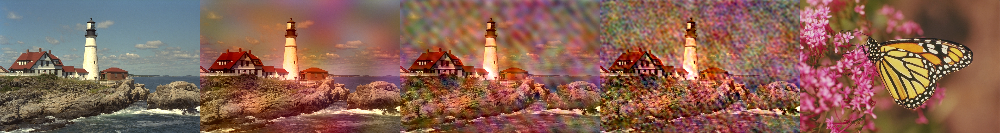

# Julia Fourier Domain Adaptation (FDA)

A Julia implementation of **FDA: Fourier Domain Adaptation** (Yang & Soatto,
CVPR 2020) — a simple, training-free technique for closing the visual style
gap between two image domains by swapping low-frequency amplitude spectra in
the Fourier domain, while leaving phase (structure/content) untouched.

## Algorithm

For each color channel independently:

1. Compute the FFT of both the source and target images and `fftshift` them
   so the zero-frequency (DC) component sits at the center:
   ```
   F_src = fftshift(fft(src)),   F_tar = fftshift(fft(tar))
   ```
2. Split the source spectrum into **amplitude** (`|F_src|`, encodes
   style/illumination/color) and **phase** (`angle(F_src)`, encodes
   structure/content).
3. Swap only a small **central low-frequency window** of the amplitude
   spectrum with the target's:
   ```
   amp_new[center ± β·size/2] = |F_tar|[center ± β·size/2]
   ```
   `β` controls how much of the low-frequency band is replaced — larger `β`
   transfers more of the target's style (and, if too large, its texture too).
4. Reconstruct with the source's original phase and inverse FFT:
   ```
   out = ifft(ifftshift(amp_new .* exp(i * angle(F_src))))
   ```

Because phase is left untouched, the source image's content/structure is
preserved almost exactly, while its low-level color/illumination statistics
shift toward the target domain — a cheap way to reduce domain gap for e.g.
synthetic-to-real semantic segmentation training, without any network
training.

## Usage

```bash
julia --project=. -e 'import Pkg; Pkg.instantiate()'
julia --project=. fourier_domain_adaptation.jl
```

`fourier_domain_adaptation.jl` uses two color sample images from Julia's
`TestImages.jl` package as two different visual domains:

- **Source**: `lighthouse` (512×768) — a cool-toned, crisp daylight outdoor
  photo
- **Target**: `monarch_color` (512×768) — a warm-toned natural-light photo

and produces FDA output at `β = 0.01, 0.05, 0.15`.

## Example result

Panels left to right: **source**, `β=0.01`, `β=0.05`, `β=0.15`, **target**



At `β=0.01`, the lighthouse scene's structure (building, rocks, waves) is
preserved essentially perfectly while the overall color grading shifts to a
warm, sunset-like palette reminiscent of the target image — a clean style
transfer. At `β=0.05` and especially `β=0.15`, enough of the mid/low
frequency band gets swapped that the target's own texture leaks in as
colorful noise/mottling. This matches the trade-off described in the
original paper, which keeps `β` small (roughly 0.01–0.09) for this reason.

## API

```julia
fda_channel(src, tar, beta) -> Matrix{Float64}
fda(src_rgb, tar_rgb, beta) -> Matrix{RGB{N0f8}}
```

- `fda_channel`: applies the amplitude-swap FDA operation to a single
  grayscale-valued channel.
- `fda`: applies `fda_channel` to each of the R, G, B channels of two
  equally-sized color images and recombines them.

## Dependencies

- [Images.jl](https://github.com/JuliaImages/Images.jl)
- [TestImages.jl](https://github.com/JuliaImages/TestImages.jl)
- [FFTW.jl](https://github.com/JuliaMath/FFTW.jl)
- [ImageIO.jl](https://github.com/JuliaIO/ImageIO.jl)

## Reference

- Y. Yang and S. Soatto, "FDA: Fourier Domain Adaptation for Semantic
  Segmentation," *CVPR*, 2020.
