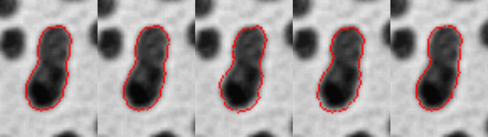
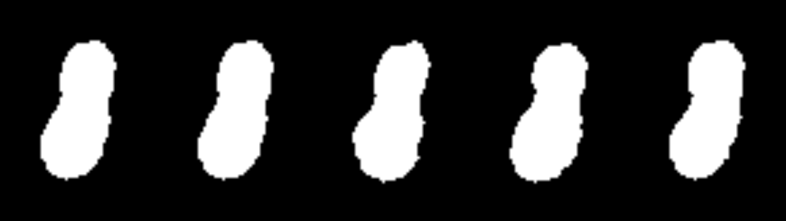

# Julia Fourier Descriptor Mask Jittering

A Julia implementation of contour **jittering** using **Fourier Descriptors**
— generating randomized but plausible variants of an object's boundary,
intended for **segmentation mask data augmentation**. It is the counterpart
of [Fourier descriptor contour *smoothing*](https://github.com/bemoregt/Julia_FourierDescriptor_Smoothing-):
instead of removing high-frequency detail, controlled random noise is added
to the frequency-domain representation of the contour before reconstructing
it back to a filled mask.

## Algorithm

1. **Segment & isolate a single blob**: threshold the image to a binary mask,
   then keep only the largest 8-connected component (`largest_component`).
2. **Trace the boundary**: classic **Moore-Neighbor tracing** extracts an
   ordered, clockwise sequence of `(row, col)` boundary pixels
   (`moore_boundary_trace`).
3. **Fourier Descriptors**: represent the boundary as a complex sequence
   `z_n = x_n + i*y_n` and take its FFT, `Z = fft(z)`.
4. **Jitter the spectrum** (`jitter_descriptors`): add random complex noise to
   each harmonic `k` with `|k| >= keep_low`. The noise's *spatial* amplitude
   is set directly in pixels — `base_amplitude` at the lowest jittered
   harmonic, decaying as `1/|k|^decay` for higher ones — rather than being
   proportional to that harmonic's own magnitude. (Scaling by each harmonic's
   own magnitude was tried first and failed for near-perfect shapes: a
   circle's higher harmonics are already ~0, so proportional noise vanishes.
   An absolute pixel-amplitude budget produces visible, naturally-decaying
   wiggle regardless of the base shape.) The lowest `keep_low` harmonics
   (position, overall size/rotation) are left untouched so the object's
   location and scale are preserved.
5. **Reconstruct & rasterize**: inverse FFT gives the jittered boundary
   coordinates; consecutive points are connected with Bresenham line drawing
   and the interior is filled with a BFS flood fill from the centroid
   (`rasterize_contour`), producing a new binary mask ready to use as an
   augmented training sample.

## Usage

```bash
julia --project=. -e 'import Pkg; Pkg.instantiate()'
julia --project=. fourier_descriptor_jitter.jl
```

`fourier_descriptor_jitter.jl` uses the `blobs` sample image bundled with
Julia's `TestImages.jl` package, binarizes it, isolates the largest
connected dark blob (a peanut-shaped pair of touching colonies, 118 boundary
pixels), and generates 4 jittered variants (`base_amplitude=1.0, decay=1.8,
keep_low=2`) from different random seeds.

## Example result

Panels left to right: **original**, then jittered variants from seeds
`101, 202, 303, 404`.

**Contour overlay** (zoomed):


**Rasterized masks** (zoomed):


Each variant keeps the object's overall peanut shape and two-lobe "waist"
recognizable, while the boundary detail varies naturally and smoothly from
one seed to the next — the kind of realistic shape diversity useful for
augmenting a segmentation training set.

## API

```julia
largest_component(mask) -> BitMatrix
moore_boundary_trace(mask) -> Vector{Tuple{Int,Int}}
jitter_descriptors(Z, rng; base_amplitude, decay, keep_low) -> Vector{ComplexF64}
rasterize_contour(pts, rows, cols) -> BitMatrix
```

- `largest_component`: keeps only the largest 8-connected component of a
  binary mask.
- `moore_boundary_trace`: extracts an ordered boundary from a single-blob
  binary mask.
- `jitter_descriptors`: perturbs a Fourier Descriptor spectrum with
  frequency-decaying random noise of a specified pixel-scale amplitude.
- `rasterize_contour`: draws a closed point sequence as a filled binary mask
  (Bresenham border + BFS interior fill).

## Dependencies

- [Images.jl](https://github.com/JuliaImages/Images.jl)
- [TestImages.jl](https://github.com/JuliaImages/TestImages.jl)
- [FFTW.jl](https://github.com/JuliaMath/FFTW.jl)
- [ImageIO.jl](https://github.com/JuliaIO/ImageIO.jl)
- `Random`, `Statistics` (standard library)

## Reference

- C. T. Zahn and R. Z. Roskies, "Fourier Descriptors for Plane Closed
  Curves," *IEEE Transactions on Computers*, C-21(3), 1972.
