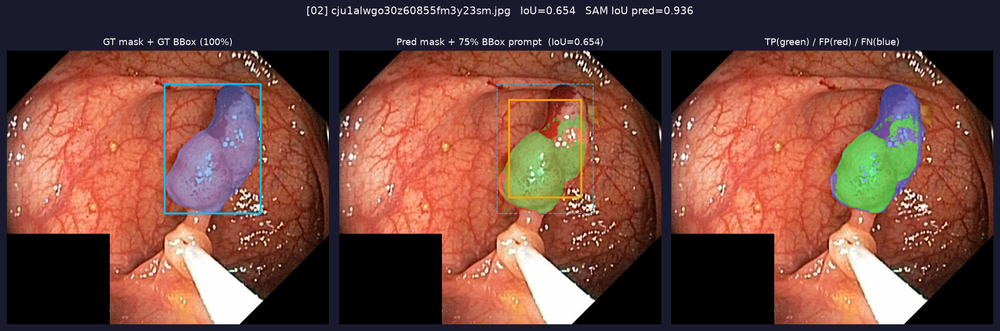
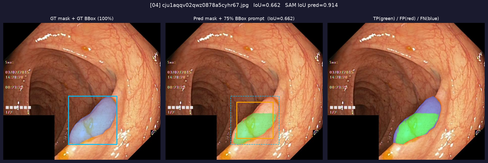
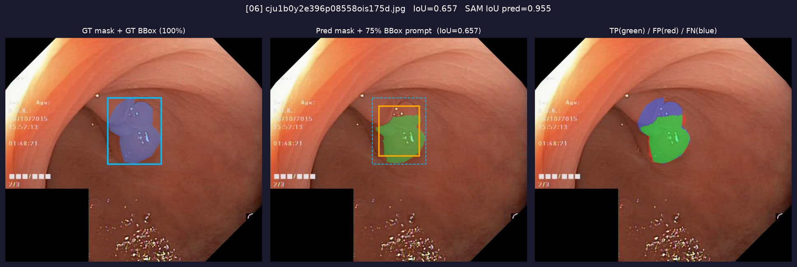
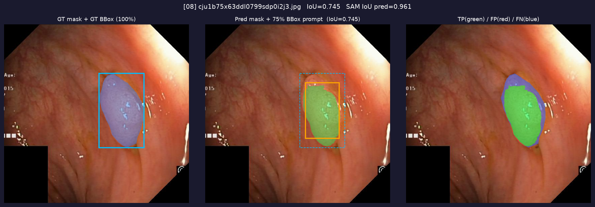
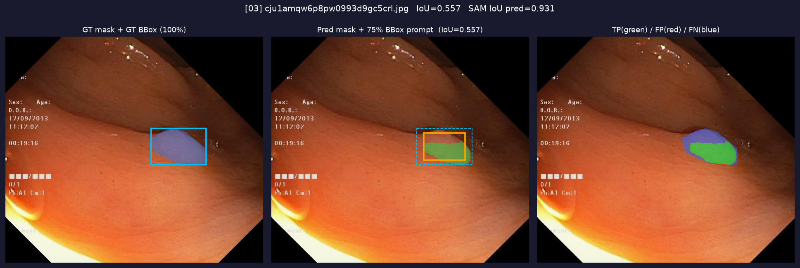
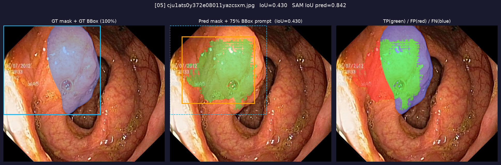
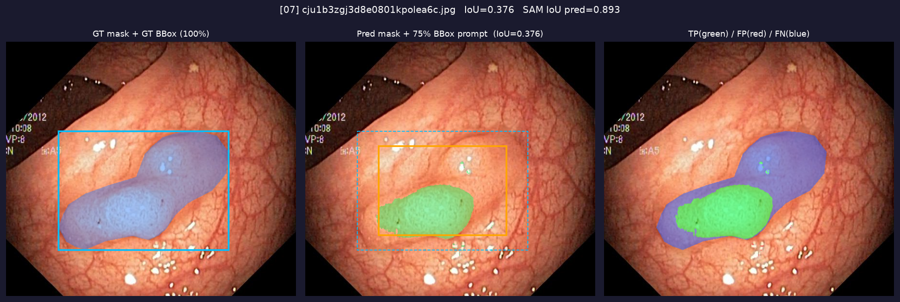
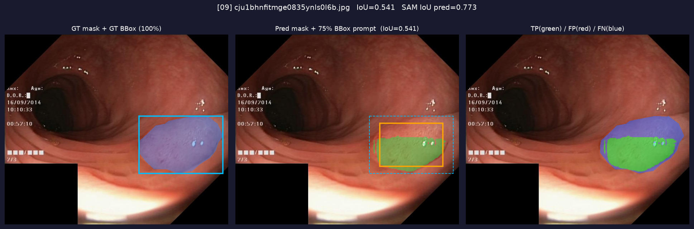
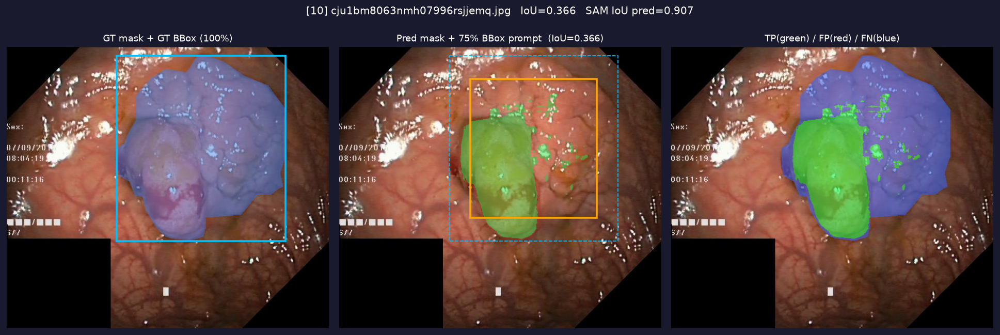
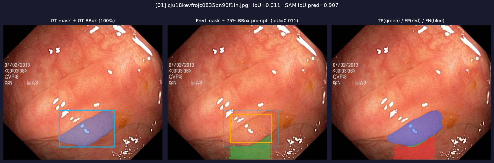

# sDCTFT Fine-Tuning for SAM (Segment Anything Model)

Julia MCP + PyCall.jl 기반으로 SAM ViT-B 모델을 sDCTFT 알고리즘으로 파인튜닝하는 프로젝트입니다.

## 논문

**Parameter-Efficient Fine-Tuning via Selective Discrete Cosine Transform**
- arXiv: [2410.09103](https://arxiv.org/abs/2410.09103)
- 핵심 아이디어: 가중치 행렬을 2D DCT로 변환 → 저/중/고주파 파티션에서 에너지 기반+랜덤 하이브리드로 소수의 DCT 계수만 선택해 학습

## 실행 환경

| 항목 | 내용 |
|---|---|
| 실행 환경 | Julia MCP (`mcp__julia__run_julia`) + PyCall.jl |
| Python | 3.13 (Julia conda 환경) |
| PyTorch | 2.12.1 |
| 가속 | Apple Silicon MPS |
| 베이스 모델 | SAM ViT-B (`sam_vit_b_01ec64.pth`, 375 MB) |
| 데이터셋 | Kvasir-SEG (폴립 분할, 1,000장, ~44 MB) |

## sDCTFT 알고리즘

```
가중치 행렬 W (M×N)
    │
    ▼ 2D DCT
주파수 행렬 W_F (M×N)
    │
    ▼ 거리 기반 파티션
┌───────────────────────────┐
│  저주파  │  중주파  │ 고주파 │  d = sqrt(u²+v²)
└───────────────────────────┘
    │
    ▼ 각 파티션에서 하이브리드 선택
    ├─ 상위 70% : 에너지(|W_F|) 기준 선택
    └─ 하위 30% : 랜덤 선택
    │
    ▼ 선택된 n개 DCT 계수만 학습 (delta_coeff)
    │
    ▼ Backward: grad_delta = DCT(grad_W)[selected]
```

### 파라미터 효율성

| 모델 | 전체 파라미터 | 학습 파라미터 | 비율 |
|---|---|---|---|
| SAM ViT-B | 93,735,472 | - | - |
| sDCTFT (n=700, 48 레이어) | 93,735,472 | **33,552** | **0.036%** |

## 프로젝트 구조

```
julia-mcp/
├── sdctft.py                          # sDCTFT 핵심 모듈
│   ├── _SDCTFTFunc                    # 미분 가능한 iDCT (custom autograd)
│   ├── SDCTFTLinear                   # nn.Linear 교체 레이어
│   ├── apply_sdctft()                 # SAM에 sDCTFT 적용
│   ├── KvasirSEG                      # 데이터셋 클래스
│   ├── seg_loss()                     # BCE + Dice Loss
│   ├── build_and_finetune()           # 학습 파이프라인
│   └── run_inference()                # 추론 + 시각화
│
├── train_sdctft.py                    # 학습 실행 스크립트
├── infer_100steps.py                  # 추론 실행 스크립트
│
├── sam_vit_b_01ec64.pth               # SAM ViT-B 원본 체크포인트
├── sam_vit_b_sdctft_kvasir_100steps.pth   # 100-step 파인튜닝 모델
├── sam_vit_b_sdctft_kvasir_1000steps.pth  # 1000-step 파인튜닝 모델
│
├── data/
│   └── Kvasir-SEG/
│       ├── images/    # 원본 내시경 이미지 (1,000장)
│       └── masks/     # GT 폴립 마스크 (1,000장)
│
└── outputs/
    ├── inference_100steps/   # 100-step 모델 추론 결과 (10장)
    └── inference_1000steps/  # 1000-step 모델 추론 결과 (10장)
```

## 실행 방법

### 1. 학습

```python
# train_sdctft.py 파라미터 수정 후 실행
python train_sdctft.py
```

또는 Julia MCP에서:

```julia
ENV["KMP_DUPLICATE_LIB_OK"] = "TRUE"
using PyCall

pybuiltin("exec")("""
import sys; sys.path.insert(0, '/Users/sgi/julia-mcp')
import sdctft, importlib; importlib.reload(sdctft)
""", PyDict{String,PyObject}())

sdctft_mod = pyimport("sdctft")
losses = sdctft_mod.build_and_finetune(
    "/Users/sgi/julia-mcp/sam_vit_b_01ec64.pth",
    n_steps     = 1000,
    max_samples = 50,
    lr          = 1e-3,
    save_path   = "sam_vit_b_sdctft_kvasir_1000steps.pth",
)
```

### 2. 추론 (75% bbox 프롬프트)

```python
results, mean_iou = sdctft.run_inference(
    orig_checkpoint      = "sam_vit_b_01ec64.pth",
    finetuned_checkpoint = "sam_vit_b_sdctft_kvasir_1000steps.pth",
    output_dir           = "outputs/inference_1000steps",
    n_images             = 10,
    bbox_scale           = 0.75,   # GT bbox를 75%로 축소해 프롬프트로 사용
)
```

## 주요 설계 결정

### 미분 가능한 iDCT (`_SDCTFTFunc`)

scipy의 iDCT는 PyTorch autograd와 연결되지 않으므로 custom `torch.autograd.Function`으로 구현:

- **Forward**: `delta_coeff` → scipy iDCT → `ΔW` → `W_base + ΔW`
- **Backward**: `grad_W` → scipy DCT → selected 위치 추출 → `grad_delta_coeff`

수학적으로: `∂L/∂delta[k] = DCT2(∂L/∂W)[u_k, v_k]`

### MPS 호환성

sDCTFT의 numpy 연산(DCT/iDCT)은 MPS와 호환되지 않으므로:
- `delta_coeff` 연산: CPU에서 수행
- SAM forward pass: MPS에서 수행
- `.to(x.device)` 로 디바이스 브리징

### 손실 함수

```python
loss = BCE(pred, gt) + Dice(pred, gt)
```

Dice loss는 폴립처럼 전경 비율이 낮은 데이터에서 클래스 불균형 완화

## 추론 결과 시각화

각 결과 이미지는 3-panel 구성:

| 패널 | 내용 |
|---|---|
| 좌 | 원본 + GT 마스크(파랑) + GT BBox 100% |
| 중 | 원본 + 예측 마스크(초록) + **75% BBox 프롬프트**(주황) |
| 우 | TP(초록) / FP(빨강) / FN(파랑) 오류 분석 |

### 100-step 파인튜닝 결과 (Kvasir-SEG, 75% bbox 프롬프트)












## 참고

- [SAM 공식 저장소](https://github.com/facebookresearch/segment-anything)
- [Kvasir-SEG 데이터셋](https://datasets.simula.no/kvasir-seg/)
- [sDCTFT 논문](https://arxiv.org/abs/2410.09103)
