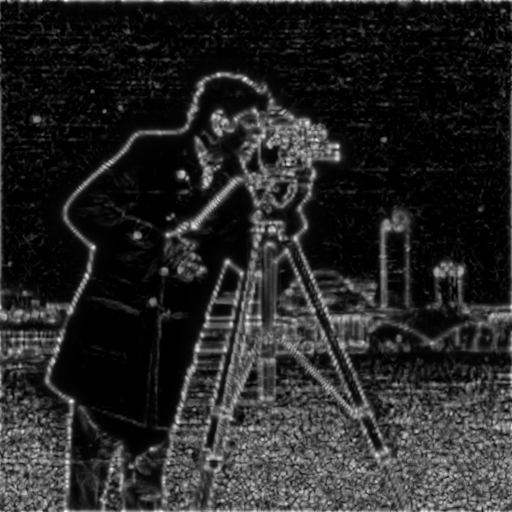

# Julia Phase Congruency Edge Filter

A Julia implementation of **Phase Congruency edge detection**, based on Kovesi's
multi-scale, multi-orientation log-Gabor filter approach. Unlike gradient-based
edge detectors (Sobel, Canny), phase congruency locates edges/features as points
where the Fourier components of the image are maximally **in phase**, which makes
it invariant to illumination and contrast changes.

## Algorithm

For every orientation `o` and scale `s`:

1. Build a **log-Gabor** radial bandpass filter in the frequency domain:
   ```
   logGabor(r) = exp(-(log(r / f0))^2 / (2 * log(sigmaOnf)^2))
   ```
   combined with a cosine-based **angular spread** filter centered at orientation `o`.
2. Apply the filter to `fft(image)` and take the inverse FFT to get a complex
   response `EO = E + iO` (even/odd filter pair) at that scale/orientation.
3. Accumulate `sumE`, `sumO`, `sumAn` (amplitude) across scales.
4. Estimate the noise threshold `T` from the first scale's amplitude via a
   Rayleigh-distribution median estimate, propagated across scales.
5. Compute phase congruency for that orientation (Morrone-Owens formulation,
   with Kovesi's noise compensation and frequency-spread weighting):
   ```
   PC_o = weight * max(|sum(E, O)| - T, 0) / (sumAn + eps)
   ```
6. Sum `PC_o` over all orientations to get the final edge map.

## Usage

```bash
julia --project=. -e 'import Pkg; Pkg.instantiate()'
julia --project=. phase_congruency.jl
```

`phase_congruency.jl` runs the filter on the `cameraman` sample image bundled
with Julia's `TestImages.jl` package and writes `pc_original.png` and
`pc_edges.png`.

## Example result

| Original | Phase Congruency Edges |
|---|---|
|  |  |

## API

```julia
phase_congruency(img; nscale=4, norient=6, minWaveLength=3.0, mult=2.1,
                  sigmaOnf=0.55, k=2.0, cutOff=0.5, g=10.0)
```

- `nscale`: number of frequency scales (filter bank bands)
- `norient`: number of orientations
- `minWaveLength`, `mult`: wavelength of the finest scale and the multiplier
  between successive scales
- `sigmaOnf`: log-Gabor filter bandwidth (smaller = narrower band)
- `k`: noise threshold multiplier (in standard deviations)
- `cutOff`, `g`: sigmoid weighting parameters that suppress responses with a
  narrow frequency spread (likely noise rather than a genuine feature)

Returns a phase congruency map normalized to `[0, 1]`.

## Dependencies

- [Images.jl](https://github.com/JuliaImages/Images.jl)
- [TestImages.jl](https://github.com/JuliaImages/TestImages.jl)
- [FFTW.jl](https://github.com/JuliaMath/FFTW.jl)
- [ImageIO.jl](https://github.com/JuliaIO/ImageIO.jl)
- `Statistics` (standard library)

## Reference

- P. Kovesi, "Image Features From Phase Congruency," *Videre: Journal of
  Computer Vision Research*, 1(3), 1999.
- M. C. Morrone and R. A. Owens, "Feature Detection from Local Energy,"
  *Pattern Recognition Letters*, 6(5), 1987.
