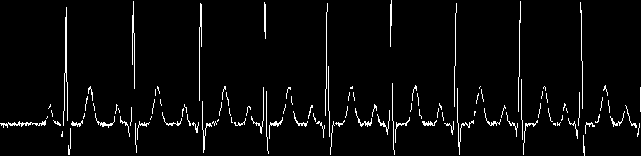
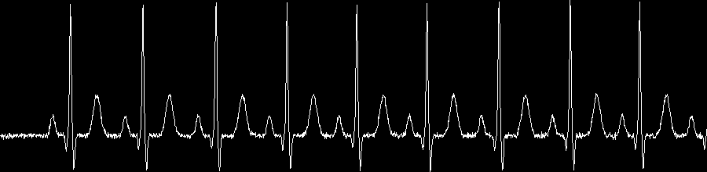
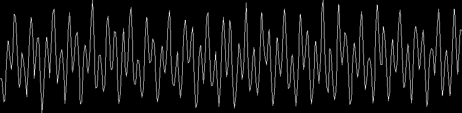
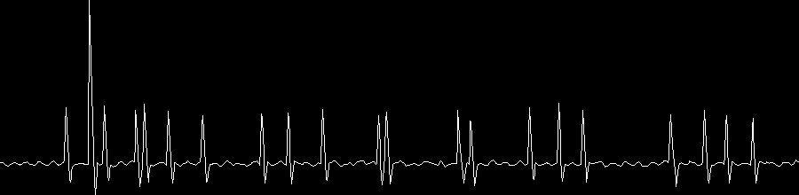
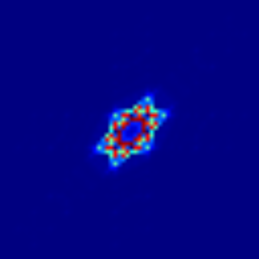
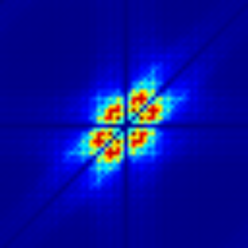

# Julia HOS ECG Arrhythmia Detection

A Julia implementation of **higher-order spectral (HOS) / bispectrum analysis
of heart rate variability (HRV)** for cardiac state discrimination, in the
spirit of:

> K. C. Chua, V. Chandran, U. R. Acharya, C. M. Lim, "Cardiac state diagnosis
> using higher order spectra of heart rate variability," *Journal of Medical
> Engineering & Technology*, 32(2), 145–155, 2008.

HRV signals (the beat-to-beat variation in heart rate) are nonlinear and
nonstationary, so conventional power-spectrum (second-order) analysis misses
the nonlinear quadratic phase coupling between frequency components. The
bispectrum — the Fourier transform of the third-order cumulant — captures
this extra structure and has been shown to discriminate cardiac states (e.g.
normal sinus rhythm vs. arrhythmia) more effectively than linear spectral
features.

> **Note on feature definitions**: the original paper is behind a paywall, so
> its exact formulas could not be verified from the full text. This
> implementation reconstructs a standard, well-established bispectrum feature
> set — normalized bispectral entropy, normalized squared bispectral entropy,
> log-amplitude moments, and weighted frequency centroids — that recurs under
> the same naming (P1, P2, H1, H2, H3, f1m, f2m) across several papers from
> the same research group (e.g. their HOS-based EEG and ECG work). It is a
> faithful reconstruction in the spirit of the method, not a verbatim
> reproduction of unseen equations.

## Pipeline

1. **Synthetic ECG generation** (`ecg_beat_template`, `generate_ecg`): each
   heartbeat's P, Q, R, S, T waves are modeled as a sum of Gaussian pulses
   placed at realistic offsets from the R-peak, then superimposed at the
   R-peak times implied by a given R-R interval sequence.
2. **HRV scenario generation**:
   - `make_rr_normal`: normal sinus rhythm — R-R intervals modulated by
     respiratory sinus arrhythmia (~0.25 Hz) and slower autonomic (~0.1 Hz,
     LF) oscillations plus small noise.
   - `make_rr_arrhythmic`: the same baseline variability, but with randomly
     inserted premature-beat / compensatory-pause pairs (short R-R followed
     by a long R-R), mimicking ectopic beats.
3. **HRV resampling** (`resample_hrv`): the irregular R-R tachogram is
   converted to instantaneous heart rate and linearly interpolated onto a
   uniform 4 Hz time base — standard HRV preprocessing required for spectral
   analysis.
4. **Bispectrum estimation** (`bispectrum`): direct (segment-averaging)
   method — `B(k1,k2) = E[X(k1) X(k2) X*(k1+k2)]` over overlapping
   Hann-windowed segments of the resampled HRV signal.
5. **HOS feature extraction** (`hos_features`) over the bispectrum's
   non-redundant principal domain (`principal_domain`):
   - `P1`: normalized bispectral entropy (Shannon entropy of the magnitude
     distribution)
   - `P2`: normalized bispectral squared entropy (entropy of the energy
     distribution)
   - `H1`, `H2`, `H3`: sum, mean, and standard deviation of log-amplitude
   - `f1m`, `f2m`: amplitude-weighted centroid frequency along each bispectrum
     axis
6. **Group comparison**: features are computed over 15 independently
   generated trials per class, and compared with a self-contained Welch
   t-test (normal-approximation p-value) — analogous to the ANOVA-based
   validation in the original paper.

## Usage

```bash
julia --project=. -e 'import Pkg; Pkg.instantiate()'
julia --project=. hos_hrv_cardiac_diagnosis.jl
```

## Example result

**ECG waveforms** (8 s excerpt) — normal (regular) vs. arrhythmic (irregular
beat spacing from inserted ectopic events):




**HRV tachograms** (interpolated instantaneous heart rate):




**Bispectrum magnitude** (jet pseudocolor, `fftshift`-centered so the DC/
low-frequency component sits at the middle of the image instead of a
corner): the normal case shows energy tightly concentrated near the center,
while the arrhythmic case shows energy spread across a much wider region —
directly reflecting its higher entropy and higher centroid-frequency
features below.




**Group statistics (15 trials each, mean ± std, Welch t-test)** — every
feature separates the two classes with `|t| > 11` and `p ≈ 0`:

| Feature | Normal | Arrhythmic | t | p (approx.) |
|---|---|---|---|---|
| P1 | 0.534 ± 0.010 | 0.811 ± 0.030 | -33.42 | ~0 |
| P2 | 0.407 ± 0.015 | 0.617 ± 0.023 | -30.15 | ~0 |
| H1 | 83.3 ± 50.2 | 3337.6 ± 329.4 | -37.83 | ~0 |
| H2 | 0.288 ± 0.174 | 11.549 ± 1.140 | -37.83 | ~0 |
| H3 | 2.639 ± 0.074 | 1.516 ± 0.360 | 11.84 | ~0 |
| f1m (Hz) | 0.232 ± 0.010 | 0.474 ± 0.043 | -21.43 | ~0 |
| f2m (Hz) | 0.102 ± 0.006 | 0.199 ± 0.015 | -23.19 | ~0 |

## API

```julia
generate_ecg(rr_intervals, fs) -> (t, ecg, rpeak_times)
make_rr_normal(n_beats; rng) -> Vector{Float64}
make_rr_arrhythmic(n_beats; rng) -> Vector{Float64}
resample_hrv(rr; fs_interp) -> (t_uniform, hr_uniform)
bispectrum(x; nseg, overlap) -> Matrix{ComplexF64}
principal_domain(nseg) -> Vector{Tuple{Int,Int}}
hos_features(B, dom, fs, nseg) -> NamedTuple
welch_t_pvalue(a, b) -> (t, p)
pseudocolor_image(M) -> Matrix{RGB{N0f8}}
```

## Dependencies

- [FFTW.jl](https://github.com/JuliaMath/FFTW.jl)
- [Images.jl](https://github.com/JuliaImages/Images.jl) / [ImageIO.jl](https://github.com/JuliaIO/ImageIO.jl)
- `Random`, `Statistics` (standard library)

No plotting package is used — line plots, tachograms, and the pseudocolor
bispectrum heatmap are all rendered with small hand-written, dependency-free
helpers (`line_plot`, `jet_colormap`).

## Reference

- K. C. Chua, V. Chandran, U. R. Acharya, C. M. Lim, "Cardiac state diagnosis
  using higher order spectra of heart rate variability," *Journal of Medical
  Engineering & Technology*, 32(2), 145–155, 2008.
- U. R. Acharya et al., "Cardiac Health Diagnosis Using Higher Order Spectra
  and Support Vector Machine," 2009 (related follow-up work by the same
  group, open access).
