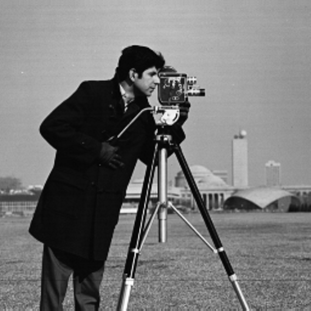
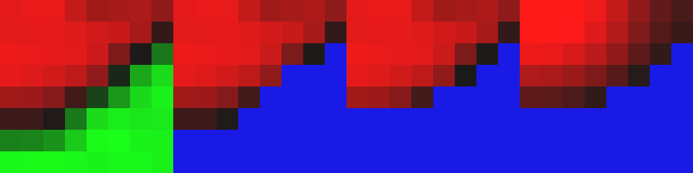
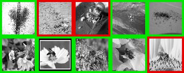

# Julia JPEG Transform Domain ResNet

A from-scratch Julia implementation and verification of the core mechanisms
from **Deep Residual Learning in the JPEG Transform Domain** (Ehrlich &
Davis, *ICCV 2019*), [arXiv:1812.11690](https://arxiv.org/abs/1812.11690).

JPEG compression (through step 4 of the standard algorithm — block DCT
followed by quantization, before the lossy rounding step) is a **linear,
invertible map**. This paper exploits that linearity to redefine every
operation in a ResNet — convolution, batch normalization, the residual
(skip-connection) addition, and global average pooling — directly on
compressed/quantized DCT coefficients, without ever fully decompressing the
image. ReLU is the one non-linear operation, so the paper introduces
**Approximated Spatial Masking (ASM)**: a way to apply a piecewise-linear
function to transform-domain data with a tunable accuracy/speed trade-off.

## Algorithm

**JPEG Transform Domain** (Section 3.1–3.2): an image is split into
non-overlapping 8×8 blocks; each block gets an orthonormal 2D DCT-II. The
paper defines the "JPEG Transform Domain" as the output right after dividing
by the quantization table (step 4) — *before* the lossy rounding step (step
5) — so this representation is exactly invertible.

**Convolution** (`Ξ`, eq. 11–13): decompressing, convolving in the pixel
domain, and recompressing is *not an approximation* — it is a single
composed linear map. Because full decompression reconstructs the entire
image (not per-block), this works correctly even when the convolution
kernel spans an 8×8 block boundary.

**ReLU via ASM** (Section 4.2, the paper's key novel technique): by
Theorem 1 (DCT least-squares approximation), reconstructing a block from
only its lowest `m` (zig-zag ordered) frequencies is the *optimal* `m`-term
least-squares approximation of that block. ASM uses this cheap partial
reconstruction only to estimate the **sign** of each pixel (a binary mask),
then multiplies that mask by the block's **exact**, full-resolution
reconstruction — so pixel *values* are always exact, and error is confined
to mask boundaries. This is strictly more accurate than the naive
alternative (computing ReLU directly on the `m`-term approximate pixel
values, called APX in the paper), which gets both the mask *and* the values
wrong.

**BatchNorm** (Section 4.3): `BN(I) = γ(I-E[I])/√(Var[I]+ε) + β` is a global
affine transform, so it becomes a uniform scalar multiply on *all* DCT
coefficients plus a constant offset added only to each block's DC
coefficient (Theorem 1: the DC coefficient of an `N×N` block is proportional
to the block's mean, `DC = mean·N`; Theorem 2: by Parseval's identity,
`Var[X] = E[Y²]` when `E[X]=0`, i.e. variance equals the AC-coefficient energy).

**Residual addition** (Section 4.4) and **global average pooling**
(Section 4.5) are even simpler: the DCT is linear, so `DCT(A+B) = DCT(A) +
DCT(B)` — skip connections are literal tensor addition — and since each
block's DC coefficient already *is* that block's mean, global average
pooling is just reading (and rescaling) the DC coefficients, no extra
computation needed.

## What this script verifies

`jpeg_domain_resnet.jl` implements every operation above from scratch (only
`FFTW.jl` for the DCT — no deep learning framework) and numerically verifies
each mathematical claim on a real 512×512 test image:

1. **Lossless round-trip** — `decompress(compress(img))` reconstructs the
   image to floating-point precision (no rounding applied yet); a separate
   `compress_lossy` (with rounding + the standard luminance quant table)
   shows a realistic ~39dB PSNR for actual lossy JPEG.
2. **Theorem 1 & 2** — DC coefficient vs. block mean, and Parseval-derived
   variance, checked directly against the code's own DCT normalization.
3. **Convolution equivalence (Ξ)** — `decompress → conv → compress` matches
   direct spatial convolution to ~1e-15, including at kernel positions that
   cross 8×8 block boundaries.
4. **ASM vs. APX ReLU accuracy** — reproduces the paper's own Section 5.3 /
   Figure 4a experiment: RMSE of both approximations against true ReLU,
   swept over `m = 1..15` frequencies on 20,000 box-filter-upsampled random
   blocks. ASM is more accurate at every `m` (~1.3× lower RMSE on average).
4b. **Figure 1 reproduction** — a real high-contrast 8×8 block from the test
   image, color-coded (green=negative, red=positive, blue=masked-zero) for
   the original block, true ReLU, ASM, and APX at `m=6`.
5. **BatchNorm equivalence** — DCT-domain BN matches spatial-domain BN to
   ~1e-15.
6. **Residual addition linearity** and **GAP-from-DC** — both exact to
   floating-point precision.
7. **End-to-end mini residual block** (`Conv → BN → ASM-ReLU → +skip`,
   entirely in the JPEG transform domain) compared against the identical
   pipeline run in the spatial domain, at increasing `m` — the deviation
   between the two shrinks monotonically and hits **exactly 0** at `m=64`
   (full frequency resolution, i.e. no ReLU approximation at all), directly
   confirming the paper's Table 1 finding that the JPEG-domain and
   spatial-domain networks are mathematically equivalent.

## Usage

```bash
julia --project=. -e 'import Pkg; Pkg.instantiate()'
julia --project=. jpeg_domain_resnet.jl
```

## Example result

```
[1] JPEG 변환 영역 왕복 오차 (반올림 이전이므로 무손실이어야 함)
  max|img - decompress(compress(img))| = 7.77e-16
  (참고) 반올림 포함 진짜 손실 JPEG(품질 50) PSNR = 38.89 dB

[2] Theorem 1 (DC=블록평균×bs) / Theorem 2 (Parseval -> 분산=Σ(AC²)/bs²) 검증
  DC(F[1,1]) = 4.9157   mean(blk)*8 = 4.9157
  Var(blk) = 3.358e-5   Σ(AC²)/64 = 3.358e-5

[3] 압축영역 합성곱(Ξ) 등가성: decompress→conv→compress == 직접 공간 합성곱
  max|decompress(jpeg_domain_conv(J,K)) - conv2d(img,K)| = 3.11e-15

[4] ReLU 근사 정확도: ASM vs 직접근사(APX), m=1..15 주파수 (Figure 4a 재현)
  m    ASM RMSE   APX RMSE   ASM/APX 비
  1    0.352      0.371      1.05
  6    0.251      0.303      1.21
  10   0.183      0.259      1.42
  15   0.133      0.224      1.69
  -> 모든 m에서 ASM이 APX보다 낮은 RMSE (평균 1.33배 더 정확)

[5] DCT 영역 BatchNorm ↔ 공간 영역 BatchNorm 등가성 검증
  max|decompress(dct_domain_batchnorm(J)) - spatial_batchnorm(img)| = 4.44e-15

[6] 잔차 덧셈 선형성 및 GAP=DC 평균 검증
  max|dct2(A+B) - (dct2(A)+dct2(B))| = 3.55e-15
  |mean(img) - GAP_from_DC(J)| = 5.55e-17

[7] 미니 잔차 블록 전체 파이프라인 비교 (Table 1 재현)
  m=4    ->  spatial-vs-JPEG 편차(RMSE) = 0.678491
  m=8    ->  spatial-vs-JPEG 편차(RMSE) = 0.252190
  m=15   ->  spatial-vs-JPEG 편차(RMSE) = 0.150371
  m=64   ->  spatial-vs-JPEG 편차(RMSE) = 0.0  (전체 주파수 사용, ReLU 근사 없음)
```

| Source (512×512) | Figure 1 reproduction: original \| true ReLU \| ASM (m=6) \| APX (m=6) |
|---|---|
|  |  |

In the Figure 1 reproduction, note that the ASM panel preserves the same
vivid red pixel *intensities* as the true-ReLU panel (only the mask boundary
differs slightly), while the APX panel looks visibly washed out — because
APX also degrades the pixel *values* themselves, not just the mask, exactly
as the paper describes.

## API

```julia
dct2_blocks(img, bs=8) / idct2_blocks(J, bs=8)     # block-wise orthonormal 2D DCT / inverse
compress(img; bs, Q) / decompress(J; bs, Q)         # JPEG Transform Domain (pre-rounding, lossless)
compress_lossy(img; bs, Q)                          # true lossy JPEG (includes step-5 rounding)

conv2d_same(img, kernel)                            # reference spatial convolution
jpeg_domain_conv(J, kernel; bs)                      # Ξ: convolution computed via the JPEG domain

zigzag_order(n)                                      # standard JPEG zig-zag index order
partial_idct_block(F, m; zz)                         # Theorem 1's m-term least-squares reconstruction
asm_relu_block(F, m; zz)                             # ASM ReLU (paper's technique)
direct_approx_relu_block(F, m; zz)                   # APX ReLU (baseline comparison)
true_relu_block(F)                                   # exact ReLU (ground truth)
relu_approx_rmse(; nblocks, bs, ms)                  # reproduces Figure 4a's RMSE-vs-m sweep

dct_domain_batchnorm(J, γ, β, E_I, Var_I; bs, eps)   # BatchNorm computed in the JPEG domain
spatial_batchnorm(img, γ, β, E_I, Var_I; eps)        # reference spatial BatchNorm

global_avg_from_dc(J; bs)                            # GAP read directly off DC coefficients

jpeg_domain_residual_block(img, kernel, γ, β; bs, m) # Conv -> BN -> ASM-ReLU -> +skip, JPEG domain
spatial_residual_block(img, kernel, γ, β)            # same pipeline, spatial domain (reference)
```

## Application: Ants vs. Bees Classification (`bees_ants_classifier.jl`)

A second script applies the paper's **Section 4.6 Model Conversion**
procedure to a real classification task, using the classic
[hymenoptera_data](https://download.pytorch.org/tutorial/hymenoptera_data.zip)
ants/bees dataset (244 train / 153 val images). The dataset itself is not
bundled in this repo (it's the standard PyTorch transfer-learning tutorial
dataset) — download and unzip it so that `hymenoptera_data/{train,val}/{ants,bees}/*.jpg`
sits as a **sibling directory** to this repo folder (`bees_ants_classifier.jl`
looks for it at `joinpath(@__DIR__, "..", "hymenoptera_data")`), or edit the
`root` path in `main()`.

The pipeline:

1. **Train a small residual CNN in the spatial domain** — `Conv(3×3,1→C) →
   BN → ReLU → Conv(3×3,C→C) → BN → (+skip) → ReLU → GlobalAveragePool →
   Linear(C→2)` — using ordinary backpropagation via
   [Zygote.jl](https://github.com/FluxML/Zygote.jl) automatic
   differentiation and a hand-written Adam optimizer (no Flux/deep-learning
   framework — every layer, including the 3×3 convolution, batch norm, and
   the training loop, is written from scratch as plain vectorized array
   operations). Images are 64×64 grayscale, `C=8` channels.
2. **Convert the trained weights into the JPEG transform domain** —
   directly reusing `jpeg_domain_resnet.jl`'s already-verified primitives:
   `jpeg_domain_conv` for each input→output channel pair (looped, since
   convolution is per-channel-pair linear), `dct_domain_batchnorm` applied
   per channel, `asm_relu_block` applied per channel per 8×8 block for the
   non-linearity, `global_avg_from_dc` for pooling, and simple tensor
   addition for the residual connection.
3. **Evaluate both domains** on the validation set and compare accuracy
   across ASM frequency counts `m`.

```bash
julia --project=. -e 'import Pkg; Pkg.instantiate()'
julia --project=. bees_ants_classifier.jl
```

### Example result

```
[2] 공간 영역에서 잔차 블록 학습 (Zygote 자동미분, Adam), 150 epochs
  epoch 150  loss=0.5556  train acc=0.742

[3] 공간 영역(spatial) 최종 정확도
  train accuracy = 0.7418
  val   accuracy = 0.6340

[4] 모델 변환(Section 4.6): 동일 가중치를 JPEG 변환 영역에서 순전파, m별 정확도 비교
  m (ASM 주파수 수)   JPEG val acc    spatial과의 편차
  4                   0.6340          0.0000
  8                   0.6405          0.0065
  15                  0.6209          0.0131
  32                  0.6144          0.0196
  64                  0.6340          0.0000
```

At `m=64` (full frequency resolution — i.e. no ReLU approximation at all),
the JPEG-domain model's validation accuracy is **exactly identical** to the
spatial-domain model's, on real trained weights and a real dataset — the
same conclusion as the paper's own Table 1 experiment (spatial and JPEG
testing accuracies match to floating-point precision), now confirmed
end-to-end on a genuine classification task rather than only on synthetic
blocks. At lower `m` the ASM approximation introduces a small, bounded
accuracy gap (≤2 points here), which is exactly the tunable speed/accuracy
trade-off the paper describes.



Sample validation predictions run entirely through the JPEG transform domain
(green border = correct, red border = incorrect).

### API

```julia
load_split(root, split; sz)                          # loads/resizes/grayscales a train or val split
model_forward(p, x) / model_forward_eval(p, x, bn)    # spatial model, training-mode / fixed-BN inference
train!(p, Xtr, Ytr, ytr; epochs, lr)                  # Zygote + hand-written Adam training loop
jpeg_domain_forward_single(p, bn, img; bs, m)         # same trained weights, run in the JPEG domain
jpeg_domain_accuracy(p, bn, X, y; bs, m)              # JPEG-domain validation accuracy at a given m
```

## Dependencies

- [FFTW.jl](https://github.com/JuliaMath/FFTW.jl)
- [Images.jl](https://github.com/JuliaImages/Images.jl)
- [TestImages.jl](https://github.com/JuliaImages/TestImages.jl)
- [ImageIO.jl](https://github.com/JuliaIO/ImageIO.jl)
- [Zygote.jl](https://github.com/FluxML/Zygote.jl) (only for `bees_ants_classifier.jl`'s training loop)
- `Random`, `Statistics` (standard library)

## Reference

- M. Ehrlich, L. Davis, "Deep Residual Learning in the JPEG Transform
  Domain," *ICCV 2019*. [arXiv:1812.11690](https://arxiv.org/abs/1812.11690)
