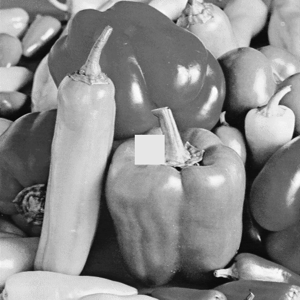
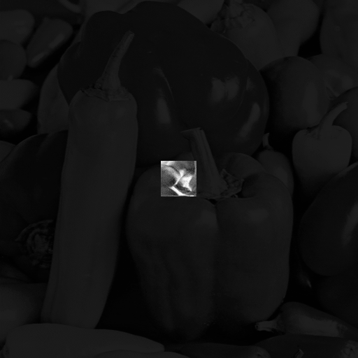
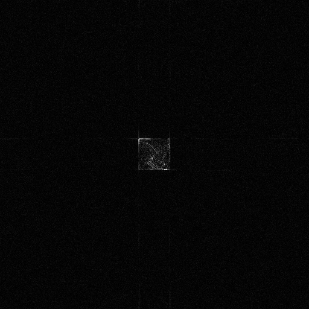

# Julia Phase Discrepancy Filter

A Julia implementation of **Phase Discrepancy (PD)** difference imaging — a
change/defect-detection method that computes the difference image in the
**frequency domain** rather than by naive pixel-wise subtraction in the
spatial domain. It is far more robust to global illumination and contrast
differences between two images than a plain `|img1 - img2|` difference.

## Algorithm

By the classical Oppenheim–Lim (1981) result, the *phase* spectrum of an
image's Fourier transform carries almost all of its structural (edge/shape)
information, while the *magnitude* spectrum mostly encodes brightness and
contrast/energy. Phase Discrepancy exploits this split:

1. For each image, compute the FFT and discard the magnitude spectrum,
   replacing it with unit magnitude everywhere, while keeping the original
   phase — then inverse-FFT back to the spatial domain:
   ```
   P(x,y) = IFFT(exp(i * angle(FFT(image))))(x,y)
   ```
   This "phase-only" reconstruction depends only on the image's structure.
2. Compute the two images' phase-only reconstructions, `P1` and `P2`, and take
   their difference in the spatial domain:
   ```
   PD(x,y) = P1(x,y) - P2(x,y)
   ```

Because FFT is linear, a purely affine brightness/contrast change
(`image2 = a * image1 + b`, no saturation) leaves the phase of every
non-DC frequency component **exactly unchanged** — only the DC term (which
carries no phase information used here) is affected. So `PD` is theoretically
invariant to such global illumination changes and lights up only where the
two images genuinely differ in local structure (e.g., an inserted defect or
foreign object).

## Usage

```bash
julia --project=. -e 'import Pkg; Pkg.instantiate()'
julia --project=. phase_discrepancy.jl
```

`phase_discrepancy.jl` loads the `peppers_gray` sample image bundled with
Julia's `TestImages.jl` package as the reference, builds a test image by (1)
applying a linear brightness/contrast change (`test = ref * 1.12 + 0.02`,
kept within `[0, 1]` to avoid saturation) and (2) pasting a local synthetic
defect patch near the center, then compares a naive spatial difference
against the Phase Discrepancy map.

## Example result

```
Image size:                (512, 512)
Defect location (row, col): (231:281, 231:281)

Naive spatial diff        - overall mean = 0.0784, defect-region mean = 0.4178
Phase Discrepancy (PD)    - overall mean = 0.0004, defect-region mean = 0.0022
```

| Reference | Test (brightness/contrast shift + defect) |
|---|---|
|  |  |

| Naive spatial difference | Phase Discrepancy (frequency-domain) difference |
|---|---|
|  |  |

The naive difference image is washed out by the global brightness/contrast
change across the whole frame. The Phase Discrepancy map stays essentially
black everywhere except the inserted defect patch, since the global affine
change does not perturb phase — only the genuine local structural change does.

## API

```julia
phase_only_image(img) -> Matrix{Float64}
phase_discrepancy(img1, img2) -> (pd, P1, P2)
```

- `phase_only_image`: reconstructs an image from unit-magnitude spectrum and
  original phase only.
- `phase_discrepancy`: returns the phase-only reconstructions `P1`, `P2` of
  both inputs and their spatial-domain difference `pd`.

## Dependencies

- [Images.jl](https://github.com/JuliaImages/Images.jl)
- [TestImages.jl](https://github.com/JuliaImages/TestImages.jl)
- [FFTW.jl](https://github.com/JuliaMath/FFTW.jl)
- [ImageIO.jl](https://github.com/JuliaIO/ImageIO.jl)
- `Statistics` (standard library)

## Reference

- A. V. Oppenheim and J. S. Lim, "The importance of phase in signals,"
  *Proceedings of the IEEE*, 69(5), 1981.
