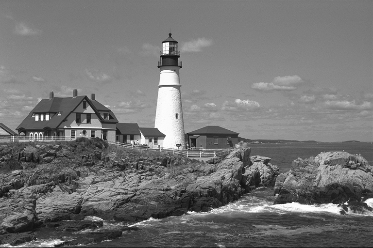
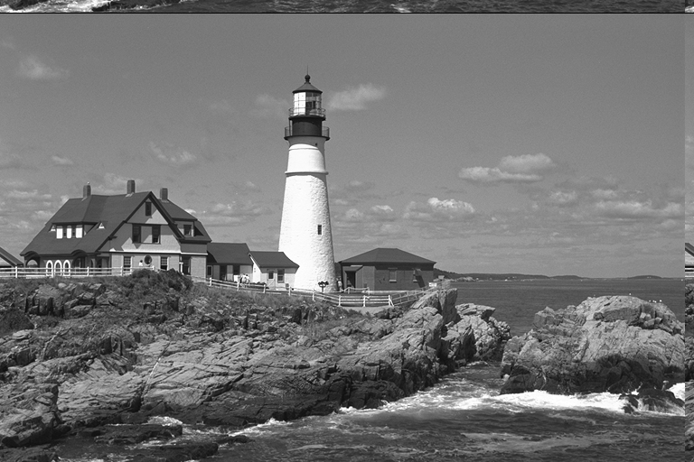
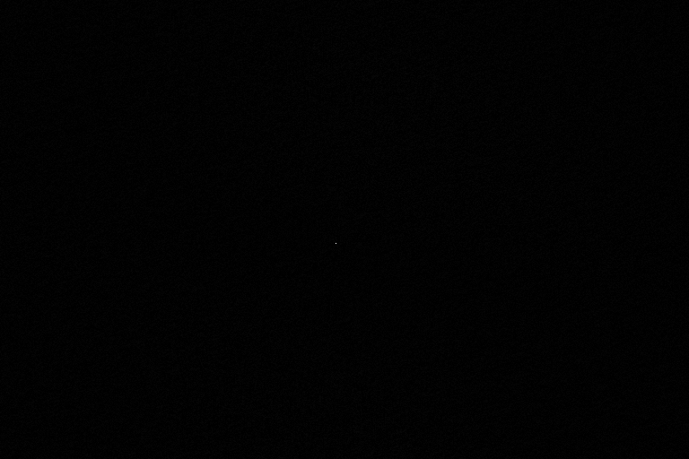

# Julia Phase-Only Correlation Filter

A Julia implementation of **Phase-Only Correlation (POC)** for estimating the
translational shift between two images. POC uses only the phase component of
the cross-power spectrum (discarding amplitude), which produces a very sharp
correlation peak at the true displacement and makes the estimate robust to
illumination and contrast differences between the two images.

## Algorithm

Given two images `img1` and `img2` of the same size:

1. Apply a 2D **Hanning window** to both images to suppress edge discontinuities
   that would otherwise leak into the phase spectrum.
2. Compute their FFTs, `F1` and `F2`.
3. Form the **cross-power spectrum** and normalize away the amplitude, keeping
   only the phase:
   ```
   R(u,v) = F2(u,v) * conj(F1(u,v)) / |F2(u,v) * conj(F1(u,v))|
   ```
4. Inverse FFT `R` to get the POC map:
   ```
   poc(x,y) = IFFT(R)(x,y)
   ```
   `poc` is (ideally) a Kronecker delta centered at the displacement between
   `img1` and `img2`; `fftshift` is applied so the zero-shift position sits at
   the center of the map for easy visualization.
5. The peak location of the (shifted) POC map, measured relative to its center,
   gives the estimated `(dy, dx)` shift, and the peak height is a normalized
   similarity/confidence score (close to `1` for a clean match).

## Usage

```bash
julia --project=. -e 'import Pkg; Pkg.instantiate()'
julia --project=. phase_only_correlation.jl
```

`phase_only_correlation.jl` loads the `lighthouse` sample image bundled with
Julia's `TestImages.jl` package, creates a second image by circularly shifting
it by a known `(dy, dx) = (15, -10)` pixel offset, and recovers that shift from
the POC map peak.

## Example result

```
Image size:            (512, 768)
True shift (dy, dx):     (15, -10)
Estimated shift (dy, dx): (15, -10)
Correlation peak value:  0.987
```

| Image 1 (original) | Image 2 (shifted) | POC map (peak at shift) |
|---|---|---|
|  |  |  |

The POC map is nearly all black except for a single bright point offset from
the center by exactly the true `(dy, dx)` shift — the map is visualized with a
square-root contrast stretch since the peak is extremely sharp relative to the
background.

## API

```julia
phase_only_correlation(img1, img2; window=true) -> Matrix
find_peak(poc) -> (dy, dx, peak_value)
```

- `phase_only_correlation`: returns the (fftshift-centered) POC map between two
  equally-sized images. Set `window=false` to skip Hanning windowing.
- `find_peak`: locates the maximum in the POC map and converts it to a shift
  relative to the map's center.

## Dependencies

- [Images.jl](https://github.com/JuliaImages/Images.jl)
- [TestImages.jl](https://github.com/JuliaImages/TestImages.jl)
- [FFTW.jl](https://github.com/JuliaMath/FFTW.jl)
- [ImageIO.jl](https://github.com/JuliaIO/ImageIO.jl)

## Reference

- C. D. Kuglin and D. C. Hines, "The phase correlation image alignment
  method," *Proc. IEEE Int. Conf. on Cybernetics and Society*, 1975.
- K. Takita, T. Aoki, Y. Sasaki, T. Higuchi, K. Kobayashi, "High-Accuracy
  Subpixel Image Registration Based on Phase-Only Correlation," *IEICE Trans.
  Fundamentals*, E86-A(8), 2003.
