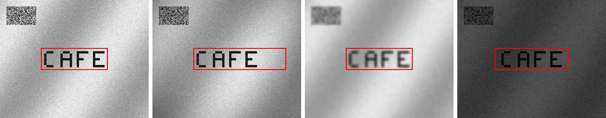

# Julia JPEG Text Localization (DCT domain)

A from-scratch Julia implementation of **Simple and Efficient Text
Localization for Compressed Image in Mobile Phone** (Kim, Canedo-Rodriguez,
Kim & Kelly, *Journal of Signal and Information Processing*, 2014),
[DOI:10.4236/jsip.2014.54022](https://doi.org/10.4236/jsip.2014.54022).

Most photos taken on a mobile phone are stored as JPEG, which already
computes an 8×8 block **DCT** for every block during compression. This
paper exploits that: instead of decompressing the image and running an
expensive spatial texture/edge analysis to find signboard text, it localizes
text directly from the DCT coefficients JPEG already produced — cheap enough
to run on a low-power mobile device.

## Algorithm

> **Note on faithfulness**: the source material available when this was
> implemented had the paper's inline equations (2)–(14) lost during
> PDF→text extraction — only the equation numbers survived, not the
> mathematical bodies. The implementation below is a careful reconstruction
> of the algorithm's *design intent* from the surrounding prose (Section 3),
> not a verbatim transcription of the original formulas/constants.

**Block text energy** (Eq. 2–3 reconstruction): each 8×8 luminance block is
transformed with an orthonormal 2D DCT-II. Text strokes, unlike most
backgrounds, produce strong energy concentrated on the block's *pure*
horizontal-frequency axis (`u=0, v=1..7`) and *pure* vertical-frequency axis
(`u=1..7, v=0`) simultaneously — this is defined as the Block Horizontal /
Vertical Text Energy (BHTE / BVTE).

**Row search** (Section 3, Figure 4–5): BHTE/BVTE are summed across each row
of blocks to build a row-wise text-energy profile `T_row(i) = ΣH(i)·ΣV(i)`.
Rows are thresholded at the profile mean, contiguous candidate line-groups
are collected, and the best one is chosen by an energy-times-centrality
score (Eq. 8 reconstruction: `energy / (1 + distance to image center)`) —
this favors the group the user actually centered the camera on, rather than
whichever patch has the most raw energy. A second, local threshold pass
around that choice refines the row boundaries (Figure 5).

**Column search** (Eq. 9–10 reconstruction): within the chosen row band, the
column-wise BHTE/BVTE sums are each smoothed with a window-3 median filter,
multiplied together, and median-filtered once more to get a smooth column
profile `S(j)`.

**Iterative background-level estimation** (Eq. 11–14, Figure 7): `S(j)` is
normalized to `[0,1]`, then a Ridler–Calvard-style iterative threshold finds
the background level — repeatedly averaging over the "below threshold"
group until its variance stabilizes below `ε`. Columns above the converged
threshold are the foreground/text candidates; among the resulting groups,
the one closest to the row band's midpoint ("the middle peak") is the final
text width.

## Usage

```bash
julia --project=. -e 'import Pkg; Pkg.instantiate()'
julia --project=. dct_text_localization.jl
```

## Demo

Since the paper targets real signboard photos (not available here), the
script synthesizes a scene: a 5×7 bitmap-font "CAFE" sign on an unevenly-lit
background, plus a high-frequency noise patch in the top-left corner as a
distractor — testing whether the centrality term in the row/column
candidate selection correctly ignores it.

The same scene is run under four conditions mirroring the paper's Figure 9
(uneven lighting / blur / dim light robustness examples):

```
[2] 기본 조건 및 Figure 9 스타일 강건성 조건들에 대한 로컬라이제이션 결과
  [baseline     ] ~9 ms   블록 rows[14:19] cols[12:29]   픽셀 rows[105:152] cols[89:232]
  [uneven_light ] ~9 ms   블록 rows[14:19] cols[12:36]   픽셀 rows[105:152] cols[89:288]
  [blurred      ] ~9 ms   블록 rows[14:19] cols[12:29]   픽셀 rows[105:152] cols[89:232]
  [dim_light    ] ~9 ms   블록 rows[14:19] cols[11:30]   픽셀 rows[105:152] cols[81:240]
```

(first call includes one-time JIT compilation; the paper reports 0.12s for
a 0.3 MP image on a 2008-era Pentium 4 — our ~9ms per 0.08 MP frame after
warmup is consistent with that being a cheap, mobile-friendly operation.)

The word is correctly boxed in every condition, and the top-left noise patch
is correctly ignored every time because of the centrality term in candidate
selection:



Left to right: baseline, vignette-style uneven lighting, Gaussian blur, dim
light.

## API

```julia
block_text_energy(img, bs=8)                 # -> (BHTE, BVTE) per-block direction energy (Eq.2-3)
localize_text_dct(img; bs, var_eps, max_iter) # -> TextLocResult (block-grid r1,r2,c1,c2 + profiles)
pixel_bbox(res, bs=8)                         # block bounds -> pixel bounding box

medfilt3(v)                                   # window-3 median filter (Eq.9-10)
find_groups(mask)                             # contiguous true-runs of a boolean vector

make_scene(; rows, cols, word, seed)          # synthetic signboard test scene
render_text(word; scale, gap)                 # 5x7 bitmap font renderer
uneven_lighting(img) / blurred_image(img) / dim_light(img)  # Figure 9-style robustness variants
draw_bbox!(img, r1,r2,c1,c2)                  # overlay the result box for visualization
```

## Dependencies

- [FFTW.jl](https://github.com/JuliaMath/FFTW.jl)
- [Images.jl](https://github.com/JuliaImages/Images.jl) / [ImageIO.jl](https://github.com/JuliaIO/ImageIO.jl)
- [ImageFiltering.jl](https://github.com/JuliaImages/ImageFiltering.jl) (Gaussian blur for the robustness demo)
- `Random`, `Statistics` (standard library)

## Reference

- J.H. Kim, A. Canedo-Rodriguez, J.H. Kim, J. Kelly, "Simple and Efficient
  Text Localization for Compressed Image in Mobile Phone," *Journal of
  Signal and Information Processing*, 5, 208-228, 2014.
  [DOI:10.4236/jsip.2014.54022](https://doi.org/10.4236/jsip.2014.54022)
