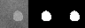
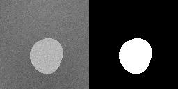

# Resolution-Invariant Medical Image Segmentation with Fourier Neural Operators (Julia)

A from-scratch Julia/Flux reproduction of the core idea in:

- Liu, Veldhuis & Brune, *"Resolution-Invariant Medical Image Segmentation
  Using Fourier Neural Operators"*, MIUA 2024 (LNCS vol. 14860, pp. 127-142).
  DOI: [10.1007/978-3-031-66958-3_10](https://doi.org/10.1007/978-3-031-66958-3_10)

The paper trains a Fourier Neural Operator (FNO) segmentation model on
64x64 images and shows it stays accurate on 32x32 up to 256x256 inputs
*without retraining*, using only 500 low-resolution training images. The
full paper is paywalled and its exact dataset/architecture/hyperparameters
are not public, so this repo reproduces the *mechanism* (an FNO-based
segmentation network trained once at a single low resolution, evaluated at
several unseen resolutions) on a synthetic dataset designed specifically to
make that evaluation meaningful — see [Limitations](#limitations-vs-the-paper).

## How it works

### The FNO layer (`src/FNO.jl`)

A Fourier Neural Operator layer (Li et al., 2020, *"Fourier Neural Operator
for Parametric PDEs"*) is a global convolution computed in the frequency
domain:

1. 2D FFT the input.
2. Multiply only the lowest `modes1 x modes2` frequencies by a learnable
   complex channel-mixing weight (a small `Cout x Cin x modes1 x modes2`
   tensor).
3. Zero out every higher frequency.
4. Inverse FFT back to the spatial domain.

Combined with a local 1x1-conv skip connection and a nonlinearity, this
forms one `FNOBlock`. Stacking `lift -> FNOBlock x depth -> project` gives
`FNOSeg`, a full segmentation network.

**Why this is resolution-invariant:** nothing in any layer's parameter
shape depends on the input height/width `H, W` — only on the *fixed*
`modes1, modes2`. The exact same trained weights can therefore be applied
to any input resolution `>= modes`, unlike an ordinary CNN whose learned
spatial kernels implicitly encode a fixed receptive field relative to a
specific pixel grid.

All layers operate on `(C, H, W, N)` arrays (channels, height, width,
batch) and are implemented **without in-place array mutation** — `cat`,
`zeros`, and broadcasting only — so that Zygote's reverse-mode autodiff can
differentiate through the FFT/inverse-FFT pipeline. This was verified
directly (`test_fft_grad.jl`) against finite differences before building
the rest of the network, after confirming that a naive in-place-mutating
implementation (`X[1:modes,1:modes] .*= ...`) is *not* Zygote-differentiable.

### Synthetic data (`src/SyntheticData.jl`)

Since the paper's dataset isn't public, `BlobShape` defines a smooth,
star-shaped 2D region as a **continuous** function of `(x,y) in [0,1]^2`
(the boundary radius is a truncated Fourier series in angle). Because the
shape is a continuous function rather than a fixed bitmap, it can be
rasterized at *any* resolution with a well-defined, consistent ground truth
— this is what makes the resolution-invariance evaluation meaningful rather
than a trivial "upsample a low-res mask and compare" test.

## Project layout

```
src/FNO.jl                    SpectralConv2d, PointwiseConv, FNOBlock, FNOSeg
src/SyntheticData.jl           Continuous blob-shape generator + rasterizer
test_fft_grad.jl                Zygote-vs-finite-difference gradient check for the FFT spectral op
test_resolution_invariance.jl   Forward-pass shape/range check (random weights) across resolutions
test_synthetic_data.jl          Saves example synthetic image/mask pairs
train.jl                        Trains FNOSeg at 64x64 on 500 synthetic shapes, saves checkpoints/fno_seg.bson
eval_resolutions.jl              Loads the checkpoint, evaluates (no retraining) at 32-256px, saves visualizations
output/                          PNGs written by the scripts above
checkpoints/                     Trained model weights (BSON)
```

## Requirements

Julia 1.12. Dependencies pinned in `Project.toml`/`Manifest.toml`: `Flux`,
`Zygote`, `FFTW`, `Images`, `FileIO`, `BSON`.

```bash
julia --project=. -e 'using Pkg; Pkg.instantiate()'
```

## Usage

```bash
# 1. sanity checks (optional but recommended before training)
julia --project=. test_fft_grad.jl
julia --project=. test_resolution_invariance.jl

# 2. train at 64x64 (~8-9 min on CPU for 15 epochs; override with FNO_EPOCHS)
FNO_EPOCHS=15 julia --project=. train.jl

# 3. evaluate at 32..256px with no retraining
julia --project=. eval_resolutions.jl
```

## Results

Trained **only** at 64x64 (15 epochs, BCE + soft-Dice loss, 500 synthetic
shapes), then evaluated with **no retraining** on 30 held-out shapes at each
resolution:

| Resolution | Mean Dice |
|---|---|
| 32x32   | 0.9993 |
| 64x64 (training resolution) | 0.9995 |
| 96x96   | 0.9995 |
| 128x128 | 0.9995 |
| 200x200 | 0.9996 |
| 256x256 | 0.9996 |

Dice stays essentially flat across a **64x range of pixel counts**
(32x32 = 1,024px vs. 256x256 = 65,536px), which is exactly the property the
paper reports. Qualitative example — the same held-out shape at 32x32 and
256x256 (image | ground truth | prediction), model never retrained between
the two:

**32x32:**



**256x256** (4x the training resolution):


Example synthetic training data (image | mask), same continuous shape
rendered at two different resolutions:




## Limitations vs. the paper

- **Synthetic data, not real medical images.** The paper's dataset, imaging
  modality, and organ(s) are not disclosed in the (paywalled) abstract
  available to us. The `BlobShape` generator is a stand-in designed to make
  the resolution-invariance evaluation well-posed (continuous ground truth
  at arbitrary resolution), not a claim about real anatomy.
- **Architecture/hyperparameters are our own design**, following the
  general FNO literature (Li et al., 2020), since the paper's exact layer
  widths, depth, mode counts, and training schedule are not public.
- **Task difficulty.** A single smooth blob against a mildly textured
  background is an easy segmentation task (hence Dice ~0.999). Real medical
  images with complex, multi-structure boundaries would likely show a
  larger (but, per the paper's claim and the architecture's construction,
  still bounded) gap between training and out-of-distribution test
  resolutions. What this reproduction *does* faithfully verify is the
  structural claim: an FNO's parameter count and forward-pass shape are
  fundamentally decoupled from input resolution, so a model trained once at
  a low resolution runs, unmodified, at much higher resolutions.
