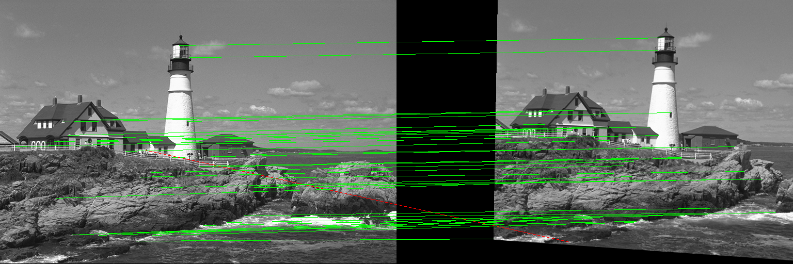
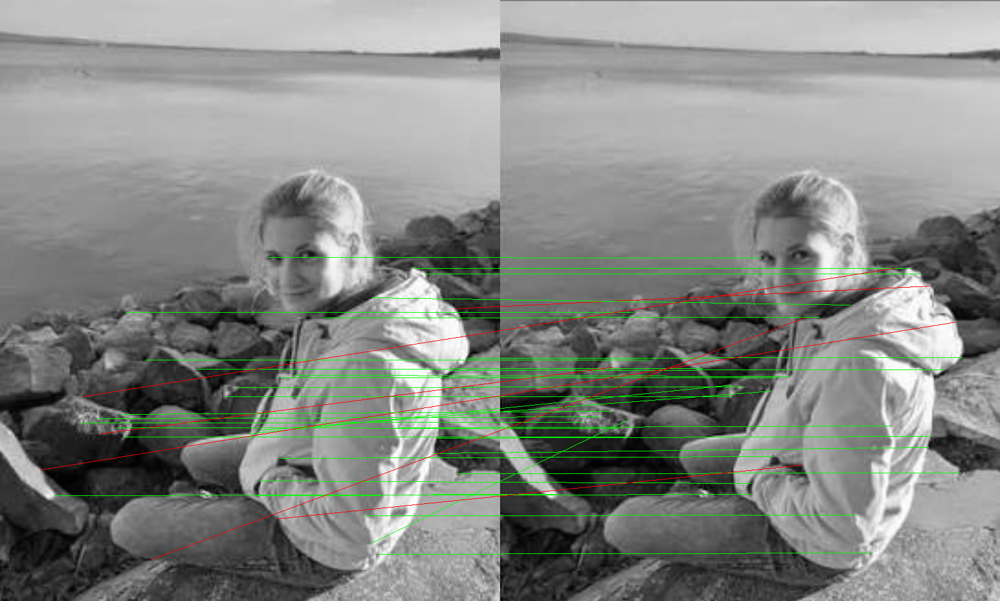

# Julia QuEst Camera Pose Estimation

A Julia implementation of quaternion-based, two-view camera pose (relative
rotation + translation direction) estimation from matched feature points, in
the spirit of:

> K. Joshi, S. Christensen, J. B. Hayet, E. Kaufmann, "Camera Pose Estimation
> from Minimal Matched Feature Points: A Quaternion-Based Approach" (QuEst),
> and the underlying paper: K. Joshi et al., "Quaternion-Based Camera Pose
> Estimation From Matched Feature Points" (arXiv:1704.02672), ICRA 2018.

QuEst recovers the relative pose between two camera views without computing a
homography or essential matrix directly — instead it parameterizes rotation
as a unit quaternion, derives a quartic polynomial system from the rigid
motion constraint `u·R·m + t = v·n` across triples of matched points, and
solves it via an eigenvalue problem, decoupling rotation recovery from
translation recovery. This lets it handle both general and coplanar point
configurations, unlike essential-matrix (fails on coplanar points) or
homography-only (needs coplanar points) methods.

## What this implements (and an important caveat)

QuEst's exact minimal-point (6-point/7-point) polynomial-eigenvalue solver
could not be verified from the paywalled/bot-gated primary source at
implementation time. This project instead implements a **mathematically
equivalent, well-established, and independently verifiable route to the same
goal** — recovering a quaternion-parameterized relative pose from matched
points, with rotation and translation handled in two decoupled stages:

1. **Rotation + translation-direction recovery**: normalized 8-point
   algorithm for the Essential Matrix `E`, singular-value decomposition into
   4 candidate `(R, t)` pairs, and **cheirality (positive-depth) voting**
   across all matches to pick the physically valid candidate — the same
   disambiguation principle QuEst uses.
2. **Quaternion conversion**: the winning rotation matrix is converted to a
   unit quaternion for reporting, matching QuEst's chosen representation.

This is a deliberate, documented substitution for QuEst's specific minimal
solver, not a claim of reproducing its exact equations.

## Pipeline

- **Harris corner detector** (`harris_response`, `top_corners`): hand-written,
  no extra feature-detection dependency — image gradients → structure tensor
  → Harris response → non-maximum suppressed top-N corners.
- **Patch-based feature matching** (`match_features`): each corner's local
  patch is compared to every candidate in the other image via **normalized
  cross-correlation (NCC)**; only **mutual best matches** are kept. Purely
  appearance-based — no coordinates are shared between images ahead of time.
- **RANSAC-robust pose estimation** (`estimate_pose_ransac`): repeatedly fits
  an essential matrix from random 8-point subsets, scores by epipolar
  residual, and keeps the consensus with the most inliers — standard
  practice for handling mismatches from real feature matching (the QuEst
  paper itself recommends RANSAC for the coplanar/ambiguous case).
- **Homography image warping** (`to_pixel_homography`, `warp_image`): for
  building a genuine second view of a real photo under a known ground-truth
  camera motion (fronto-parallel-plane assumption), via inverse mapping +
  bilinear interpolation.

## Usage

```bash
julia --project=. -e 'import Pkg; Pkg.instantiate()'
julia --project=. quaternion_pose_estimation.jl
```

The script runs four progressively more realistic tests:

### 1. Synthetic sanity check
60 random 3D points, projected into two cameras with a known ground-truth
`(R, t)`. Validates the whole pipeline end-to-end against ground truth with
no real-image noise in the loop.

**Result**: rotation error `0.0°`, translation-direction error `0.0°`,
60/60 cheirality-consistent.

### 2. Single real image + fabricated per-point depth
Harris corners from `TestImages.jl`'s `lighthouse` photo are given
made-up synthetic depths and reprojected under a known `(R, t)` — useful for
a first check, but **not a real two-viewpoint test**: there is only one real
image; the "second view" is just a re-projection of invented 3D points.

**Result** (noiseless): `0°` error, 40/40 cheirality-consistent.
**Result** (pixel noise robustness, matching QuEst's own noise experiments):

| Noise σ (px) | Rotation error | Translation-dir. error | Cheirality |
|---|---|---|---|
| 0.5 | 0.34° | 4.15° | 40/40 |
| 1.0 | 0.88° | 13.76° | 40/40 |
| 2.0 | 2.17° | 39.20° | 39/40 |

(Rotation stays comparatively stable while translation direction degrades
faster — a well-known property of two-view geometry.)

### 3. A genuine second image + independent detection + matching
This addresses a direct critique during development: test #2 didn't use two
real different-viewpoint photos. Here, the *entire* `lighthouse` image is
warped with a homography (induced by a known ground-truth `(R, t)` under a
fronto-parallel-plane assumption) to render an actual second image. Harris
corners are then detected **independently** in both images (no shared
indices), matched purely by patch appearance (NCC), and RANSAC-filtered.

**Result**: 60 corners per image → 35 NCC matches → 34/35 RANSAC inliers →
rotation error `1.31°`, translation-direction error `10.85°` (small but
nonzero, because this run has genuine warping/interpolation and independent-
detection noise in the loop, unlike test #2).



### 4. Two real, uncontrolled photos (no ground truth)
Two near-duplicate real photos of the same scene/pose. Since the true camera
motion is unknown, only the recovered pose is reported (no error metric is
possible) — this is the actual real-world use case.

> The two source photos contain an identifiable person and are **not**
> bundled in this repository for privacy reasons; only the derived match
> visualization below (already approved for publication) is included. The
> script references the original local file paths for these two photos, so
> test #4 will not run as-is on another machine — tests #1–#3 remain fully
> reproducible with the bundled `TestImages.jl` sample.

**Result**: 80 corners/photo → 38 NCC matches → 32/38 RANSAC inliers →
recovered rotation ≈ `0.3°` (near-zero, consistent with two very similar
shots), translation direction dominated by the forward/optical-axis
component — consistent with the two photos being taken moments apart from
almost the same spot.



## API

```julia
harris_response(img; sigma, k) -> Matrix{Float64}
top_corners(R, nfeat; min_dist, border) -> Vector{Tuple{Int,Int}}
essential_matrix_8point(m, n) -> Matrix{Float64}
decompose_essential(E) -> Vector{Tuple{Matrix,Vector}}
select_correct_pose(candidates, m, n) -> ((R,t), score)
estimate_pose(m, n) -> (R, t, quat, score)
estimate_pose_ransac(m, n; iters, thresh, rng) -> (R, t, quat, inliers)
match_features(img1, corners1, img2, corners2; half, min_score) -> matches
to_pixel_homography(R, t, K, plane_depth) -> Matrix{Float64}
warp_image(img, Hpix) -> Matrix{Float64}
rotmat_to_quat(R) / quat_to_rotmat(q) / quat_to_axis_angle(q)
```

## Dependencies

- [Images.jl](https://github.com/JuliaImages/Images.jl) / [ImageIO.jl](https://github.com/JuliaIO/ImageIO.jl)
- [ImageFiltering.jl](https://github.com/JuliaImages/ImageFiltering.jl)
- [TestImages.jl](https://github.com/JuliaImages/TestImages.jl)
- `LinearAlgebra`, `Random`, `Statistics` (standard library)

No dedicated feature-detection/matching or computer-vision package is used —
the Harris detector, patch matching, RANSAC, and homography warp are all
self-contained.

## References

- K. Joshi et al., "Quaternion-Based Camera Pose Estimation From Matched
  Feature Points" (QuEst), arXiv:1704.02672 / ICRA 2018.
- ["Camera Pose Estimation from Minimal Matched Feature Points: A
  Quaternion-Based Approach" (video)](https://www.youtube.com/watch?v=jQPFzpo0apc)
- R. Hartley and A. Zisserman, *Multiple View Geometry in Computer Vision*
  (essential matrix estimation and decomposition).
