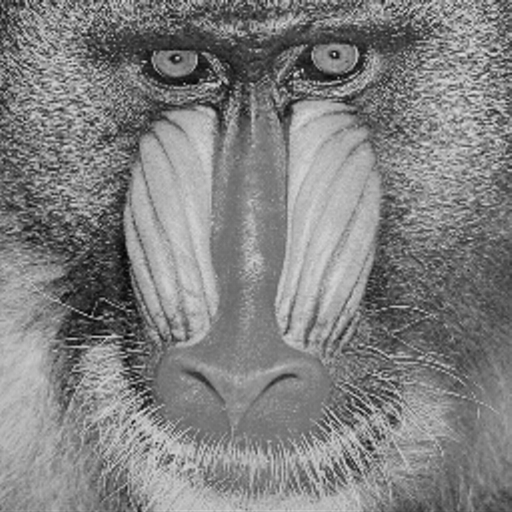
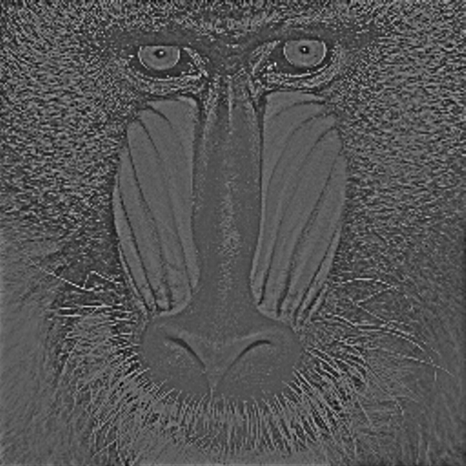

# Julia Homomorphic Filter

Julia로 구현한 준동형 필터링(Homomorphic Filtering) 예제입니다. 조명(illumination, 저주파) 성분과 반사율(reflectance, 고주파) 성분을 로그 변환으로 분리한 뒤, 주파수 영역에서 저주파는 억제하고 고주파는 강조하여 불균일한 조명을 보정하고 디테일(에지)을 살립니다.

## 알고리즘

1. **로그 변환**: `log(image + 1)` — 곱셈으로 결합된 조명·반사율 성분을 덧셈으로 분리
2. **FFT**: 로그 영상을 2D FFT로 주파수 영역 변환 (`FFTW.jl`)
3. **고주파 강조 필터**: 가우시안 기반 high-emphasis 필터
   ```
   H(u,v) = (γH − γL) · (1 − exp(−c·D²/D0²)) + γL
   ```
   - `D0`: 컷오프 반지름
   - `c`: 전이 기울기
   - `γL < 1`: 저주파(조명) 감쇠 비율
   - `γH > 1`: 고주파(반사율/에지) 증폭 비율
4. **역FFT** 후 **지수 변환**으로 로그 복원, `[0, 1]` 정규화

## 실행 방법

```bash
julia --project=. -e 'import Pkg; Pkg.instantiate()'
julia --project=. homomorphic_filter.jl
```

`homomorphic_filter.jl`은 Julia `TestImages.jl` 패키지에 내장된 샘플 이미지 `mandril_gray` (512×512 그레이스케일)에 필터를 적용하고 결과를 `original.png`, `homomorphic_filtered.png`로 저장합니다.

## 결과 예시

| 원본 | 준동형 필터 적용 |
|---|---|
|  |  |

## 요구 패키지

- [Images.jl](https://github.com/JuliaImages/Images.jl)
- [TestImages.jl](https://github.com/JuliaImages/TestImages.jl)
- [FFTW.jl](https://github.com/JuliaMath/FFTW.jl)
- [ImageIO.jl](https://github.com/JuliaIO/ImageIO.jl)
