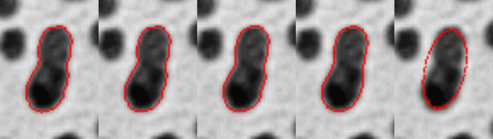

# Julia Fourier Descriptor Contour Smoothing

A Julia implementation of contour smoothing using **Fourier Descriptors**.
A closed object boundary is traced from a binary mask, represented as a
sequence of complex numbers, and transformed into the frequency domain. By
keeping only the lowest-frequency Fourier coefficients and discarding the
rest, the inverse transform reconstructs a smoothed version of the same
contour — the fewer harmonics retained, the smoother (and more simplified)
the shape becomes.

## Algorithm

1. **Segment & isolate a single blob**: threshold the image to a binary mask,
   then find connected components via 8-connectivity BFS and keep only the
   largest one (`largest_component`).
2. **Trace the boundary**: apply the classic **Moore-Neighbor tracing**
   algorithm to extract an ordered, clockwise sequence of `(row, col)`
   boundary pixels (`moore_boundary_trace`).
3. **Fourier Descriptors**: represent the boundary as a complex sequence
   `z_n = x_n + i*y_n` and take its FFT, `Z = fft(z)`. The coefficients of
   `Z` are the Fourier Descriptors of the contour.
4. **Low-pass truncation**: zero out every coefficient whose frequency index
   `k` satisfies `|k| > K`, keeping only the `K` lowest positive and negative
   harmonics plus the DC term (`low_pass_fd`).
5. **Reconstruct**: inverse FFT the truncated spectrum to get a smoothed
   complex sequence, whose real/imaginary parts are the smoothed `(x, y)`
   contour coordinates (`smooth_contour`). Smaller `K` -> more aggressive
   smoothing; `K = 1` collapses any shape down to a pure ellipse (a single
   harmonic can only describe an ellipse).

## Usage

```bash
julia --project=. -e 'import Pkg; Pkg.instantiate()'
julia --project=. fourier_descriptor_smoothing.jl
```

`fourier_descriptor_smoothing.jl` uses the `blobs` sample image bundled with
Julia's `TestImages.jl` package (a classic bacterial-colony test image), binarizes
it, isolates the largest connected dark blob (a peanut-shaped pair of touching
colonies, 118 boundary pixels), and overlays the reconstructed contour on the
image for `K = all (raw), 25, 10, 4, 1` harmonics, side by side.

## Example result

Panels left to right: **raw (K=all)**, **K=25**, **K=10**, **K=4**, **K=1**



Going from left to right: the raw, pixel-jagged boundary is progressively
smoothed as fewer harmonics are kept. The "waist" between the two touching
colonies survives at `K=25` and `K=10`, mostly disappears at `K=4`, and is
completely gone at `K=1`, where the shape has collapsed into a single smooth
ellipse.

## API

```julia
largest_component(mask) -> BitMatrix
moore_boundary_trace(mask) -> Vector{Tuple{Int,Int}}
low_pass_fd(Z, K) -> Vector{ComplexF64}
smooth_contour(boundary, K) -> Vector{ComplexF64}
```

- `largest_component`: keeps only the largest 8-connected component of a
  binary mask.
- `moore_boundary_trace`: extracts an ordered boundary from a single-blob
  binary mask.
- `low_pass_fd`: truncates a Fourier Descriptor spectrum to `|k| <= K`.
- `smooth_contour`: combines FFT, truncation, and inverse FFT to produce a
  smoothed contour for a given number of harmonics `K`.

## Dependencies

- [Images.jl](https://github.com/JuliaImages/Images.jl)
- [TestImages.jl](https://github.com/JuliaImages/TestImages.jl)
- [FFTW.jl](https://github.com/JuliaMath/FFTW.jl)
- [ImageIO.jl](https://github.com/JuliaIO/ImageIO.jl)

## Reference

- C. T. Zahn and R. Z. Roskies, "Fourier Descriptors for Plane Closed
  Curves," *IEEE Transactions on Computers*, C-21(3), 1972.
